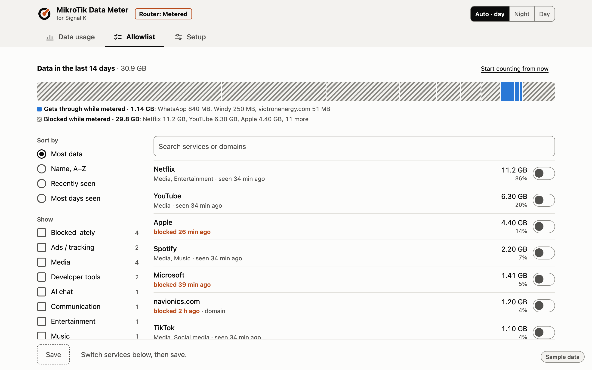
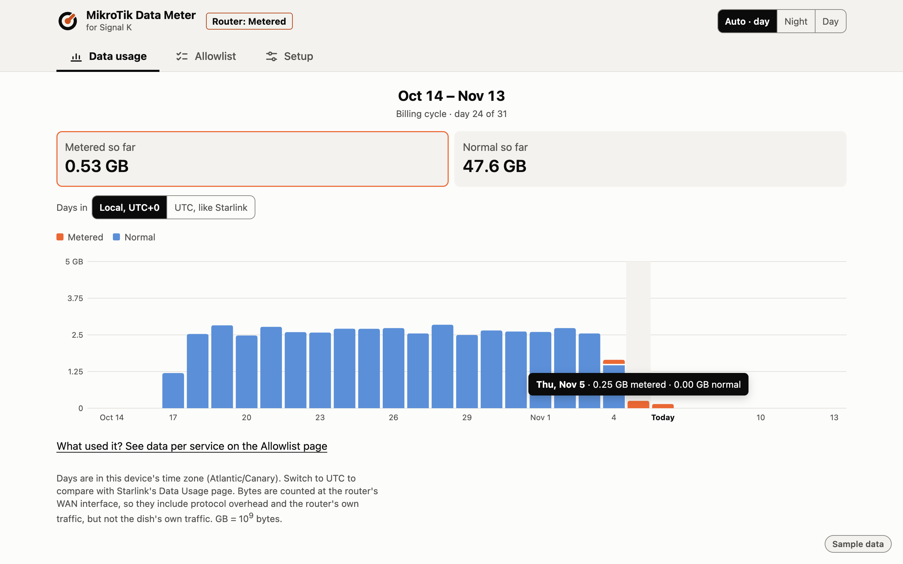
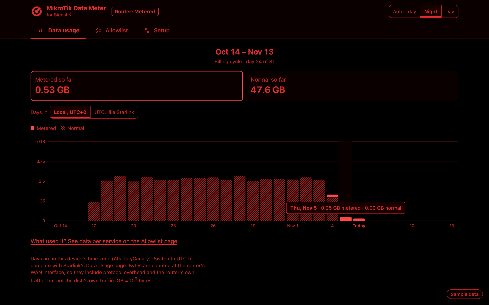
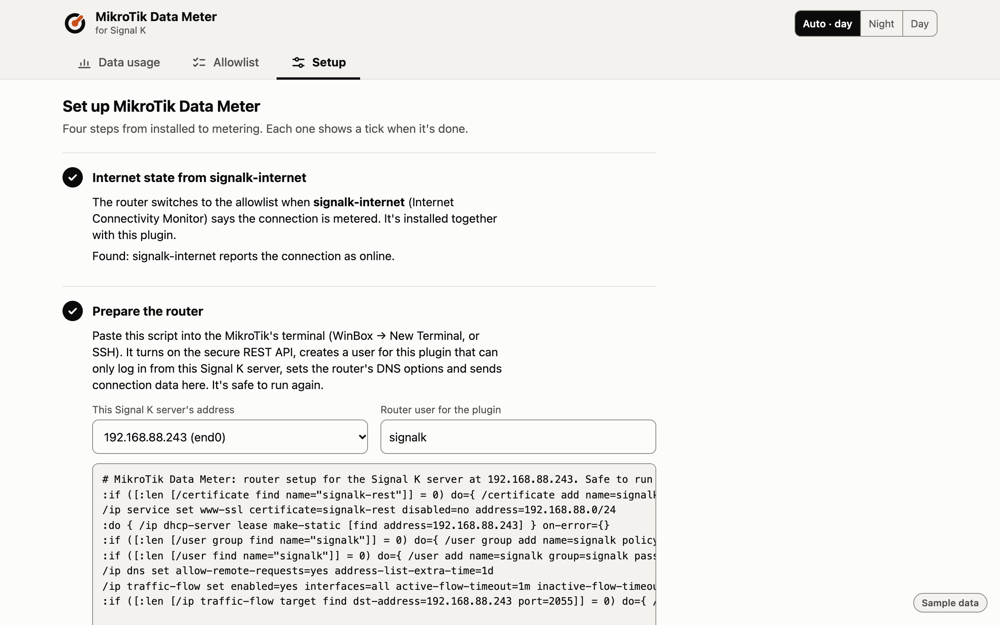

<picture>
  <source media="(prefers-color-scheme: dark)" srcset="https://raw.githubusercontent.com/stigdreyer/signalk-mikrotik/main/brand/logo/data-meter-horizontal-reversed.svg">
  
</picture>

# signalk-mikrotik

**MikroTik Data Meter** in Signal K: data metering for a MikroTik router on a metered connection.

A Signal K plugin that switches a **MikroTik** router between a **normal** and a
**metered** firewall profile, following the internet state published by
[signalk-internet](https://github.com/meri-imperiumi/signalk-internet).

It works with any metered uplink signalk-internet can report, such as roaming
LTE or satellite. The main use case is **Starlink Ocean Mode**, which is billed
per GB. While metered, only the services you choose can reach the internet. Background traffic like OS
updates, cloud sync, telemetry and streaming is dropped at the router.

The plugin also shows which services and domains your devices look up, and
what got blocked while metered, so you build the allowlist from what your crew
actually uses rather than guessing domains.



| Data usage | Night mode | Setup |
|---|---|---|
|  |  |  |

<sub>Screenshots show sample data, not a real boat's traffic.</sub>

> Not affiliated with or endorsed by MikroTik (SIA Mikrotīkls) or Starlink (SpaceX). MikroTik, RouterOS and
> Starlink are trademarks of their owners and are used here only to say what the plugin works with.

### Tested on

| Router | RouterOS | Uplink |
|---|---|---|
| hAP ax S | 7.25 | Starlink |

Used it on another router? Please [open an issue](https://github.com/stigdreyer/signalk-mikrotik/issues) with the
model, the RouterOS version and what worked, so this table grows.

## Getting started

1. Install **MikroTik Data Meter** from the Signal K Appstore and restart Signal K.
   It brings [signalk-internet](https://github.com/meri-imperiumi/signalk-internet)
   (Internet Connectivity Monitor) with it, which tells it when the connection is metered.
2. Open **MikroTik Data Meter** under Webapps. Until it's connected to a router,
   it opens on **Setup**. Saving needs a Signal K admin login.
3. Follow Setup's four steps:
   - check that signalk-internet reports the connection;
   - copy the generated script into the router's terminal. It turns on the REST API
     (`www-ssl`, limited to this server's LAN subnet), creates a user for the plugin
     that can only log in from this server, makes this server's DHCP lease static,
     and sets the router's DNS options and Traffic Flow. It's safe to run again;
   - test the connection, which changes nothing on the router;
   - set your billing day and price, then **Save and start**.
4. Open **Allowlist** and switch on what the crew needs at sea. Beyond the fixed
   lists (time sync, the connectivity checks and the Starlink app), nothing is
   allowed while metered until you pick it.

From then on the app opens on the Allowlist while the connection is metered and on
Data usage otherwise.

Until the router password is set, the plugin waits and changes nothing on the router.
If the router can't be reached, the plugin status says why in plain words and it
tries again every minute. [docs/router-setup.md](docs/router-setup.md) explains each
router step in detail.

## How it fits together

```
 Starlink app ──(you)── Ocean Mode on/off      (billing, Starlink cloud)
                            │
 Freeboard / signalk-internet override ──(you)── metered / online
                            │
              network.internet.state
                            │
                    signalk-mikrotik ──REST──▶ MikroTik: metered / normal profile
```

| Plugin | Role |
|---|---|
| [signalk-internet](https://github.com/meri-imperiumi/signalk-internet) | **Decides.** Publishes `network.internet.state` (`online` / `metered` / `captive` / `offline`) and holds the manual override (Freeboard button or REST). |
| [signalk-starlink-offshore](https://github.com/night199uk/signalk-starlink-offshore) | **Backstop.** Publishes `navigation.maritimeZone`. signalk-internet's built-in `high-seas → metered` rule locks the router if you forget the override. |
| [signalk-starlink](https://github.com/itemir/signalk-starlink) | Dish status, which signalk-internet uses for its online/offline mapping. Optional. |
| **signalk-mikrotik** (this plugin) | **Enforces.** Switches the router profile and records traffic for the allowlist. |

signalk-mikrotik doesn't detect anything on its own. It does exactly what
`network.internet.state` says.

## Usage

Starlink Ocean Mode is an account setting that you switch in the Starlink app.
The dish can't tell the boat whether it's on, so the override is set by hand to
match it.

**Going offshore**

1. Turn on **Ocean Mode** in the Starlink app.
2. Set signalk-internet to **Metered** (Freeboard Internet button).
3. signalk-mikrotik applies the **metered profile** and closes connections that
   are already open.

**Coming back**

1. Turn off **Ocean Mode** in the Starlink app.
2. Set signalk-internet to **Online** (or **Auto**).
3. signalk-mikrotik applies the **normal profile**.

### State handling

| `network.internet.state` change | Router action |
|---|---|
| → `metered` | Apply metered profile and flush the connection table |
| → `online` | Apply normal profile |
| → `offline`, `captive` | **No change** |
| → `null` (signalk-internet stopped) | **No change** |
| Plugin start | Read the current state and bring the router in line with it |

Failing safe means staying in whatever profile is active. If you forget to set
the override back to online, the router stays locked, which costs nothing. The
profile survives a router reboot. Unlike
[mikrotik-starlink-ocean-mode](https://github.com/spidgrou/mikrotik-starlink-ocean-mode),
which always boots open, a power blip at sea doesn't reopen the gate.

## The metered profile

While metered, outbound WAN traffic is allowed only to the union of three
lists:

1. **Always allowed**
   - **Uplink management:** a preset per uplink. The **Starlink** preset is on
     by default and covers the dish on the LAN (default `192.168.100.0/24`)
     plus the Starlink cloud (account, subscription, data usage). Keep it on if
     you use Starlink: without it you can't turn Ocean Mode off.
   - **Boat systems:** NTP and the signalk-internet probe hosts.
2. **What you pick on the Allowlist page** of the webapp:
   - **Services** from
     [v2fly/domain-list-community](https://github.com/v2fly/domain-list-community),
     about 1,400 of them (WhatsApp, Telegram, Docker, Netflix, …), with v2fly's
     categories. For crew safety comms, pick your messaging apps.
   - **Domains** the router has seen your devices look up that v2fly doesn't
     know.

   Everything you pick allows its subdomains too.

Everything else that goes out to WAN is dropped.

## Data usage dashboard

Every 60 seconds the plugin reads the byte counters of the WAN interfaces and
books the growth to the current UTC day and hour, split into **normal** and
**metered** by the profile that was active. The webapp shows days in the
device's own time zone, or in UTC to line up with Starlink's figures.

The **Data usage** tab shows one chart per billing cycle (set the billing day in
Setup, step 4), with the normal and metered totals and each day's numbers on hover
or tap. The arrows step back through earlier cycles. You can check it against
Starlink's own Data Usage page.

The same numbers are published to Signal K for KIP, Home Assistant or a
history plugin:

| Path | Value |
|---|---|
| `network.mikrotik.usage.today.normal` | bytes today (UTC), normal profile |
| `network.mikrotik.usage.today.metered` | bytes today (UTC), metered profile |
| `network.mikrotik.usage.wan.received` | bytes received since the plugin started counting |
| `network.mikrotik.usage.wan.sent` | bytes sent since the plugin started counting |

`GET /plugins/signalk-mikrotik/usage?from=YYYY-MM-DD&to=YYYY-MM-DD` returns
the daily and hourly buckets, plus the profile, billing day and price (503 while
the plugin isn't running). While the plugin or the Signal K server is down the router
keeps counting, and the gap is booked to the first sample after restart. A
router reboot loses the bytes since the last sample.

## Allowlist page

The **Allowlist** tab is where you choose what stays reachable while metered.
Every minute the plugin reads the names in the router's DNS cache and keeps, for
14 days, when each was last seen and on how many days. The page shows:

- **A data bar** on top: what gets through while metered (solid) and what is
  blocked (hatched), service by service. Pointing at a segment names it.
- **One list** with a switch per service or domain: every name a device looked
  up, grouped into its v2fly service (or its domain when v2fly doesn't know it).
  Details show the names looked up, how many domains allowing it opens, and
  v2fly's hierarchy (Apple includes iCloud, Apple TV+, Apple update, …).
- **Data volume** per service and domain over the last 14 days, with the
  metered part (needs the router's Traffic Flow export, which the Setup script
  turns on; see [router-setup.md](docs/router-setup.md#5-optional-traffic-flow-for-data-volume-per-service)).
  The router reports every connection, and the plugin books its bytes to the
  name the device looked up, following CNAMEs, so CDN traffic counts for the
  service using it. **Start counting from now** starts a second count, e.g. right
  after switching to metered, to see what still uses data. The 14-day history stays.
- **Search** over what was seen and the whole v2fly catalog, so you can allow a
  service before anyone used it, or add a domain by typing it.
- **Filter & sort** (a column beside the list; one fold-out line on a phone):
  sort by most data, name, recently seen or most days seen, and filter by
  **Blocked lately** (what devices tried while metered and didn't get), ads and
  tracking (hidden unless you ask for them) or v2fly categories.
- **A save bar** that lists what will be allowed or blocked and, when you set a
  price per GB, what allowing it may cost. While metered, saving also flushes the
  router's DNS cache, so devices ask again and get through.
- **Always allowed:** the fixed lists, for reference.

Names that are only CNAME targets (CDN hosts) are left out: nobody asked for
them, so they'd show up as blocked although their service is allowed.

Saving updates only the changed router entries. The firewall rules stay as
they are.

The page learns from the router's DNS. While metered the DNS redirect sends
every lookup there. In normal mode it only sees devices that use the router
as their DNS server, so hand out the router first via DHCP if you want to
build your list in port. The easiest way: a short session in port using each
app the way you would at sea, including the Starlink app (open Data Usage,
toggle a setting), then pick from the list.

## Logo

The Valve: a boat's through-hull valve, turned part-way open. Masters, icons and
usage rules are in [brand/](brand/README.md).

## Night mode

The header shows **Router: Metered** or **Router: Normal** and an **Auto / Night /
Day** switch. All three pages have a night mode: red on black, so nobody on watch loses
their night vision. By default it follows the vessel's day/night mode
(`environment.mode`, e.g. from signalk-derived-data), like other Signal K
apps. **Night** or **Day** in the page header forces one on that device;
**Auto** goes back to following the vessel.

## What it does on the router

Everything the plugin creates carries a `signalk-mikrotik` comment and is
managed idempotently over the RouterOS REST API. The plugin never changes
objects it didn't create. Its filter rules sit only in the `forward` chain (plus
a `dstnat` DNS redirect, an IPv6 forward drop, DNS static entries and one address
list), so router access via WinBox or SSH is never affected. On every start the
plugin runs a preflight (RouterOS version, WAN list exists and has members, DNS
options and upstream, DHCP DNS server, Traffic Flow export, IPv6) before anything
is written.

- **Address-list** `skm-metered`: the hostnames of the allowed lists, plus the
  Starlink dish subnet.
- **DNS `FWD` static entries**, one per hostname, with `match-subdomain` and
  `address-list=skm-metered`. Every IP the router hands out for an allowed
  domain or its subdomains joins the list, so the firewall allows the same
  CDN addresses your devices were given. They forward to the router's own
  upstream server and are enabled only while metered.
- **Forward-chain rules** at the top of the chain, so they run before
  defconf fasttrack:
  - accept to `skm-metered`
  - only when the DNS redirect is off: accept udp/tcp port 53
  - drop `out-interface-list=WAN`, except replies of port-forwarded (dstnat)
    connections

  All of them, the NAT redirect and the `FWD` entries are enabled only while metered.
- **DNS redirect** (on by default): while metered, port 53 from LAN goes to
  the router, whatever server a device asks. That's what makes the `FWD`
  entries see every lookup, and hard-coded resolvers can't bypass the list.
  Turned off, DNS to any server stays allowed and only devices that already
  use the router get matching IPs.
- **IPv6:** if IPv6 is enabled, all IPv6 forwarded to WAN is dropped while
  metered.
- **Connection flush** on the switch to metered, so streams and downloads that
  are already running (including fasttracked ones) stop immediately.

The router's own traffic (output chain) isn't touched.

Router warnings show on the Data usage page, and Setup's **Test connection** runs
the same checks. Over REST (admin): `GET /plugins/signalk-mikrotik/preflight` runs
them again, and `POST /plugins/signalk-mikrotik/remove` deletes every tagged
object (see [Uninstalling](#uninstalling)).

## Requirements

- **RouterOS v7** with the REST API over `www-ssl` (the Setup script turns it on
  with a self-signed certificate). v6 is refused by the preflight; the exact
  minimum v7 version is still to be settled. Optional features, such as subdomain
  matching, are detected and switched off with a warning on older versions.
- **A dedicated router user** for the plugin, with only the `read`, `write`, `api` and
  `rest-api` policies (REST on RouterOS 7.25 refuses commands with "not
  allowed (9)" without `api`). The Setup script creates it.
- **A WAN interface list** (name configurable) containing the metered uplink.
  For Starlink, use bypass mode so the dish connects straight to the
  MikroTik.
- **Router DNS that works for your clients** while metered (the redirect
  sends them all there): `allow-remote-requests=yes`, an IPv4 upstream that
  handles large answers, and `address-list-extra-time` above zero. See
  [router-setup.md](docs/router-setup.md#4-router-dns).
- **signalk-internet** (Internet Connectivity Monitor): installed with this plugin
  as a dependency, and enabled by default. signalk-starlink-offshore is optional
  and provides the high-seas backstop.
- **Signal K server** on the router's LAN, Node.js 20 or later. With Signal K's
  security on (2.31 or later), logged-in crew can use the pages and users with
  read/write access can save the allowlist; Setup needs an admin.

Step-by-step router setup: [docs/router-setup.md](docs/router-setup.md).

## Configuration

Setup fills in most settings. The rest are under Server → Plugin Config →
MikroTik Data Meter.

| Setting | Default | Set in |
|---|---|---|
| Router REST URL | `https://192.168.88.1` | Setup, step 3 |
| Router user | `signalk` | Setup, step 2 |
| Router password | empty: the plugin waits until it's set | Setup, step 3 (filled in from the script) |
| Accept self-signed router certificate | on | Setup, step 3 |
| Billing day | 1 (1 = calendar months) | Setup, step 4 |
| Price per metered GB | 0 (no cost estimate) | Setup, step 4; used by the Allowlist's save preview |
| Currency | `USD` | Setup, step 4 |
| WAN interface list | `WAN` | plugin settings |
| Redirect LAN DNS to the router while metered | on | plugin settings |
| Starlink preset | on (turn it off on boats without Starlink) | plugin settings |
| Starlink dish subnet | `192.168.100.0/24` | plugin settings |
| Traffic Flow port | 2055 (0 = off) | plugin settings |

What's allowed while metered is picked on the Allowlist page, not in the plugin
settings.

The router password is stored in Signal K's plugin settings like any other
plugin's. What limits the damage if it leaks: the router user can only log in from
the Signal K server's address and has no policies beyond `read,write,api,rest-api`.
Note that the Setup script sets `www-ssl`'s certificate and limits it to the
server's subnet, which affects WebFig over HTTPS from other subnets.

## Troubleshooting

| You see | What to do |
|---|---|
| "The router refused the user name or password" | Run the Setup script again with **New password**, then test and save. |
| "The router user lacks permissions" | The user's group needs `read,write,api,rest-api`; the Setup script sets it. |
| "The router's certificate isn't trusted" | Turn on **Accept the router's self-signed certificate** in Setup, step 3. |
| "Nothing answers at …" | The REST service is off or limited to another subnet: run the Setup script. |
| "Can't reach the router at …" or "doesn't resolve" | Check the address (use the IP) and that the Signal K server is on the router's LAN. |
| `Interface list "WAN" not found` or "has no members" | Set the WAN interface list in the plugin settings, or add the uplink to it on the router. |
| "DNS redirect needs … allow-remote-requests=yes" | Run the Setup script, or `/ip dns set allow-remote-requests=yes`. |
| A warning about DNS upstream, `address-list-extra-time`, DHCP DNS or Traffic Flow | The warning names the RouterOS command that fixes it; the Setup script sets all but the upstream and DHCP. |
| "signalk-internet isn't reporting the connection" | Install or enable Internet Connectivity Monitor: without it the router never switches. |
| An app stops working while metered | Find it under **Blocked lately** on the Allowlist, switch it on and save. |
| Locked out of the internet and Signal K is down | On the router: `/ip firewall filter disable [find comment=signalk-mikrotik]` |

## Uninstalling

Stopping or uninstalling the plugin leaves the router in its current profile, on
purpose: a crash at sea must not open the gate. So remove it in this order:

1. Set signalk-internet to **Online**, so the router is back in the normal profile.
2. Remove the plugin's router entries: `POST /plugins/signalk-mikrotik/remove` (admin),
   or on the router:
   ```routeros
   /ip firewall filter remove [find comment=signalk-mikrotik]
   /ip firewall nat remove [find comment=signalk-mikrotik]
   /ipv6 firewall filter remove [find comment=signalk-mikrotik]
   /ip dns static remove [find comment=signalk-mikrotik]
   /ip firewall address-list remove [find comment=signalk-mikrotik and dynamic=no]
   ```
3. Uninstall **MikroTik Data Meter** in the Signal K Appstore.
4. Optionally undo the Setup script: remove the router user and group `signalk`,
   the Traffic Flow target pointing at the server, and the `signalk-rest` certificate.

## Known limitations

- **Domains become IPs.** The router allows by IP, so a whitelisted domain on a
  shared CDN or cloud also opens everything else behind those IPs. Allowing
  Gmail effectively opens most of Google, and the same goes for Microsoft.
- **RouterOS compresses SRV answers**, which RFC 2782 forbids. Strict
  resolvers reject them: c-ares 1.34.8, used by some Node.js and Python
  clients, fails on lookups through the router. Fixed in c-ares 1.34.9.
- **DNS over HTTPS** in browsers bypasses the router's DNS. It is blocked while
  metered unless its provider's IPs happen to be allowed, and in that case
  those clients' data shows up as "addresses no DNS lookup explains" on the
  Allowlist page.
- **No billing truth.** Nothing tells the plugin whether Ocean Mode is actually
  on in your Starlink account. The override is yours to keep in sync. The dish's
  `disablement_code` (`IN_OCEAN` vs `OKAY`) may help on the high seas in future.
- **App host lists change.** If an app stops working while metered, allow it
  from **Blocked lately** on the Allowlist. If a service's domains are wrong,
  please fix them in v2fly/domain-list-community (see
  [CONTRIBUTING.md](CONTRIBUTING.md)).

## Contributing and changes

Bug reports and pull requests are welcome: see [CONTRIBUTING.md](CONTRIBUTING.md),
and [SECURITY.md](SECURITY.md) for security problems. What changed in each release
is in [CHANGELOG.md](CHANGELOG.md).

## Credits

- [spidgrou/mikrotik-starlink-ocean-mode](https://github.com/spidgrou/mikrotik-starlink-ocean-mode):
  the whitelist-by-address-list approach
- [meri-imperiumi/signalk-internet](https://github.com/meri-imperiumi/signalk-internet):
  connectivity state and override
- [night199uk/signalk-starlink-offshore](https://github.com/night199uk/signalk-starlink-offshore):
  maritime zones

## License

[EUPL-1.2](LICENSE) (European Union Public Licence). `data/v2fly.json` is
compiled from v2fly/domain-list-community and keeps its MIT notice in
[data/NOTICE](data/NOTICE).
